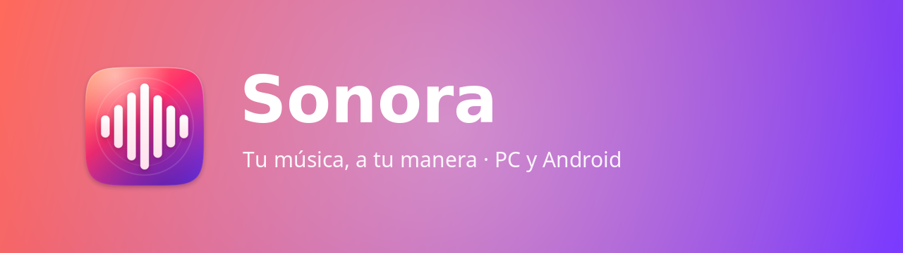
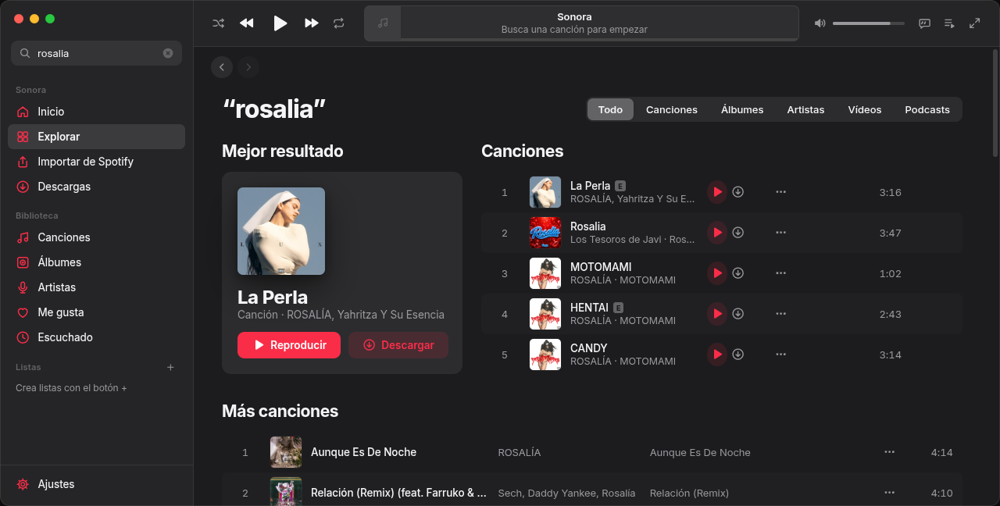
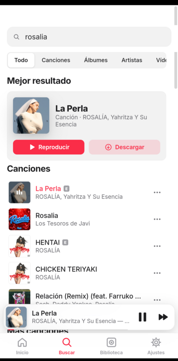
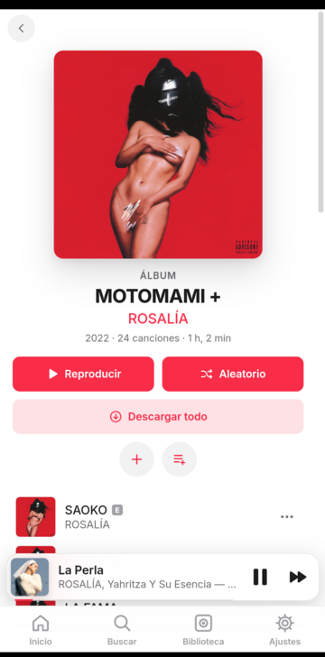

  

  <b>Reproductor de música para PC y Android.</b> 
  Busca cualquier canción, escúchala al momento o descárgala con carátula y letra sincronizada.

  
  

  
  

---

  
  

  
  
  

## ✨ Lo que hace

- 🔎 **Busca** en YouTube Music y YouTube: canciones, álbumes, artistas y podcasts. También enlaces de **Spotify**.
- ▶️ **Escucha al momento** o ⬇️ **descarga** con carátula, artista, álbum y letra.
- 🎤 **Letras sincronizadas** a pantalla completa.
- 🎨 **4 estilos** (Apple, Google, Cuadrado y Vision), modo oscuro y colores a tu gusto.
- 📚 **Biblioteca**: Me gusta, listas, álbumes, artistas… e **importar de Spotify**.
- 🔗 **Sincroniza** tu biblioteca entre el PC y el móvil con un código.
- 😴 **Temporizador para dormir**, ecualizador y mucho más.
- 🔄 **Se actualiza sola**: te avisa al abrirla cuando hay versión nueva.

## 📥 Cómo instalar

**Windows** · descarga el instalador, ábrelo y sigue los pasos. Crea un acceso directo en el escritorio.

**Android** · descarga el APK en el móvil y ábrelo. Si Android lo pide, permite *instalar apps de origen desconocido* para tu navegador o gestor de archivos.

## 🆕 Novedades de la 1.1.0

- Gasta mucho menos (menos CPU y RAM que Spotify).
- Arreglado: la música ya no se para al acabar cada canción en el móvil.
- Nuevo diseño del móvil.
- Temporizador para dormir.
- Avisos de actualizaciones y actualizaciones rápidas.

---

Sonora es un proyecto personal de <a href="https://github.com/ODev-M">ODev-M</a>. Úsalo con música a la que tengas derecho a acceder.

