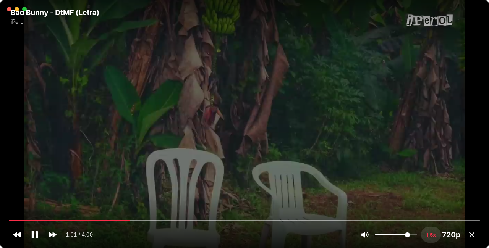
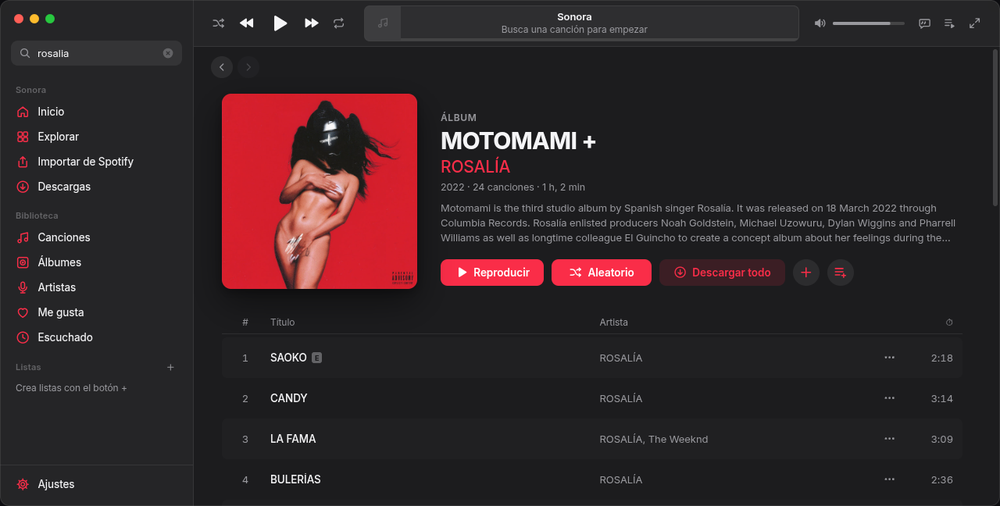
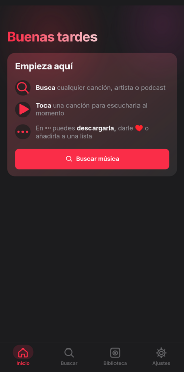
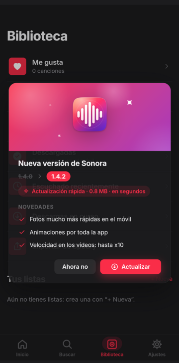
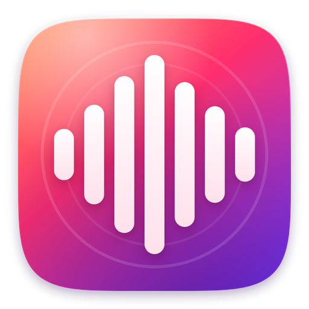

  

  <b>Tu música, a tu manera.</b> Un reproductor para PC y Android con aspecto de Apple Music: 
  busca cualquier canción, escúchala al momento, mira sus vídeos, sigue la letra y descárgala para siempre.

  
  

  
  
  
  

  <a href="#-qué-es-sonora">Qué es</a> ·
  <a href="#-capturas">Capturas</a> ·
  <a href="#-cómo-instalar">Instalar</a> ·
  <a href="#-guía-de-uso">Guía de uso</a> ·
  <a href="#️-atajos-de-teclado">Atajos</a> ·
  <a href="#-preguntas-frecuentes">Preguntas</a> ·
  <a href="#-historial-de-versiones">Versiones</a>

---

## 🎧 Qué es Sonora

Sonora es un reproductor de música **gratis, sin anuncios y sin cuenta**. Busca en el catálogo de **YouTube Music** y **YouTube** (canciones, álbumes, artistas, vídeos y podcasts), así que tienes prácticamente toda la música del mundo:

- 🔎 **Lo buscas** por nombre, artista o pegando un enlace (de Spotify o de YouTube).
- ▶️ **Lo escuchas al momento**, sin descargar nada.
- ⬇️ **O lo descargas** con su carátula, sus datos y su letra dentro del archivo, para escucharlo sin internet.

Funciona en **Windows**, **Android** y **Linux**, y tu biblioteca se puede sincronizar entre ellos con un código.

---

## 📸 Capturas

  
  

  
  

  
  
  
  
  

---

## 📥 Cómo instalar

<b>🪟 Windows</b> (10 y 11, 64 bits)

1. Descarga el **[instalador](https://github.com/ODev-M/sonora-actualizaciones/releases/latest)** (`Sonora-Instalador-….exe`).
2. Ábrelo. Si Windows enseña *"Windows protegió su PC"*, pulsa **Más información → Ejecutar de todas formas** (sale porque Sonora no es de una empresa con certificado de pago, no porque tenga nada malo).
3. Sigue los pasos: elige la carpeta, acepta y listo. Se crea un acceso directo en el escritorio.

<b>🤖 Android</b> (7.0 o más nuevo)

1. Desde el móvil, descarga el **[APK](https://github.com/ODev-M/sonora-actualizaciones/releases/latest)** (`Sonora-….apk`).
2. Ábrelo. Android te pedirá permiso para **instalar apps de origen desconocido** desde tu navegador o tu gestor de archivos: actívalo y vuelve atrás.
3. Pulsa **Instalar**. Si Play Protect avisa, pulsa **Instalar de todas formas**.
4. Abre Sonora y deja que te pida permiso de **notificaciones**: así se controla la música desde la pantalla de bloqueo.

<b>🐧 Linux</b>

De momento Sonora en Linux se usa desde su código fuente (no hay paquete). Si te interesa, abre un *issue* y se prepara uno.

### 🔄 Actualizaciones

No tienes que volver a descargar nada: **al abrir Sonora te avisa si hay versión nueva** y te enseña sus novedades.

- ⚡ **Actualización rápida** (lo normal, ~1 MB): solo baja lo nuevo y se aplica en segundos.
- 📦 **Instalador completo**: solo cuando cambia algo "de fondo". Sonora lo baja, lo instala solo y vuelve a abrirse.
- 🛟 Si algo saliera mal con una actualización rápida, Sonora vuelve sola a la versión anterior.

---

## 📖 Guía de uso

<b>🔎 Buscar y escuchar</b>

- Escribe en el buscador (en el PC arriba a la izquierda, en el móvil en la pestaña **Buscar**). Los resultados se ordenan en **Todo · Canciones · Álbumes · Artistas · Vídeos · Podcasts**.
- **Pega un enlace** de Spotify (canción, álbum, lista, artista o podcast) o de YouTube y Sonora lo encuentra.
- Toca una canción para escucharla. Las primeras de cada búsqueda y las de *Para ti* se preparan antes de que las toques, así que suenan casi al instante.
- Al acabar la cola, Sonora sigue con **canciones parecidas** (radio automática; se puede quitar en Ajustes).
- En **Explorar** tienes géneros (Éxitos, Reguetón, Pop, Trap latino, Rock, Lo‑fi…).

<b>⬇️ Descargar</b>

- Pulsa ⬇️ en cualquier canción, o **Descargar todo** en un álbum o una lista.
- La música se guarda en **M4A** (la calidad original) con su **carátula, artista, álbum y letra dentro del archivo**: se ve bien en cualquier reproductor.
- En los **vídeos de YouTube** puedes elegir: **Descargar la música** o **Descargar el vídeo (MP4)** con imagen y sonido (solo en el PC, hasta 1080p).
- Carpetas: la música va a *Música/Sonora* y los vídeos a *Vídeos/Sonora* (se cambia en Ajustes). En la pestaña **Descargas** ves el progreso.
- Lo descargado se escucha **sin internet**, y los vídeos descargados se ven sin internet dentro de Sonora.

<b>🎤 Letras</b>

- Pulsa el icono de la letra (o la tecla **L**) y la letra va **sincronizada**: la frase que se canta se ilumina y la pantalla la sigue sola.
- La letra sale de **YouTube Music** y de **lrclib**.
- **En el PC**, si una canción no tiene letra en ningún sitio, una **IA** (que funciona en tu PC, sin internet) la escucha y la escribe. Usa bastante el procesador: si juegas con Sonora abierto, apágala en **Ajustes → Sacar la letra con IA** y solo saldrán las letras de internet.

<b>🎬 Vídeos</b>

- Si lo que suena es un vídeo de YouTube (o una canción con videoclip oficial), sale un botón de **cámara** al lado de la luna (en el móvil, **Vídeo** junto a **Dormir**). Púlsalo y la carátula se cambia por el vídeo.
- **Pantalla completa** con el botón de la esquina del vídeo (o doble clic). En el móvil se pone en horizontal.
- A pantalla completa los **controles solo salen al mover el ratón** (o tocar) y se esconden solos: tiempo, anterior/siguiente, volumen, **velocidad** (0,5x · 0,75x · 1,25x · 1,5x · 2x · 3x · 5x · 8x · 10x) y **calidad** (automática, 1080p, 720p, 480p, 360p).
- La música sigue sonando aunque cierres el vídeo o apagues la pantalla, y entonces no gasta datos de vídeo.
- La velocidad también se puede cambiar para cualquier canción desde **⋯ → Velocidad**.

<b>📚 Biblioteca y "Para ti"</b>

- **Me gusta** (♥), **listas** propias, **álbumes** guardados, **artistas** seguidos, **descargadas** e **historial**.
- **Para ti**: canciones elegidas a partir de lo último que has escuchado. Se prepara en segundo plano, así que sale al instante al abrir Sonora.
- Clic derecho (o **⋯**) en cualquier canción: reproducir a continuación, añadir a la cola, a una lista, crear radio, ir al artista o al álbum, copiar enlace…

<b>🟢 Importar de Spotify</b>

Ve a **Importar de Spotify** y pega el enlace de lo que quieras traer: tus **listas**, **álbumes**, **artistas**, **canciones** o **podcasts**. Sonora busca cada canción y la añade a tu biblioteca. No hace falta iniciar sesión en Spotify (las listas tienen que ser públicas).

<b>🔗 Sincronizar el PC y el móvil</b>

1. En el PC: **Ajustes → Dispositivos** y verás un **código**.
2. En el móvil: **Ajustes → Dispositivos → Vincular** y escribe ese código (los dos en la misma red Wi‑Fi).
3. Me gusta, listas, álbumes, artistas e historial quedan sincronizados en los dos.

<b>💬 Discord</b> (en el PC)

Con Discord abierto, tu estado enseña **"Escuchando Sonora"** con la canción, el artista, la carátula, el logo de Sonora y la barra de cuánto llevas. Si estás viendo un vídeo pone **"Viendo Sonora"** con un botón **Ver el vídeo** para tus amigos. En pausa no se enseña nada.

¿No sale? Comprueba en Discord **Ajustes → Privacidad de actividad → Compartir tu actividad detectada** y que esté activado **Ajustes de Sonora → Enseñar en Discord lo que escuchas**.

<b>🎨 Personalizar</b>

- **4 estilos**: *Apple* (cristal, suave), *Google* (Material You), *Cuadrado* (líneas rectas) y *Vision* (paneles flotantes).
- **Tema** claro, oscuro o automático, **color** a elegir o **según la carátula** que suena.
- Esquinas, tipo y tamaño de letra, densidad de las listas, fondo, animaciones…
- **Ecualizador** de 10 bandas con preajustes y **CSS propio** para cambiarlo todo (en el PC).
- Pantalla *Reproduciendo* en estilo **Apple**, **Vinilo** o **Minimal**.

<b>😴 Más cosas</b>

- **Temporizador para dormir** (la luna): 15, 30, 45 min, 1 h o al acabar la canción; baja el volumen poco a poco.
- **Fundido** entre canciones, aleatorio, repetir, cola que se puede ordenar arrastrando.
- **Precarga inteligente**: lo que vas a escuchar se prepara antes y suena sin cortes; lo que no escuchas en un tiempo se borra solo.
- Controles en la **pantalla de bloqueo** y en los auriculares (móvil), y con las teclas multimedia (PC).
- Gasta poco: en el PC usa menos procesador y memoria que Spotify.

---

## ⌨️ Atajos de teclado

| Tecla | Hace |
|:---:|---|
| <kbd>Espacio</kbd> | Reproducir / pausa |
| <kbd>←</kbd> <kbd>→</kbd> | Atrás / adelante 5 s |
| <kbd>Ctrl</kbd> + <kbd>←</kbd> <kbd>→</kbd> | Canción anterior / siguiente |
| <kbd>↑</kbd> <kbd>↓</kbd> | Subir / bajar volumen |
| <kbd>L</kbd> | Letra |
| <kbd>Q</kbd> | Cola |
| <kbd>S</kbd> / <kbd>R</kbd> | Aleatorio / repetir |
| <kbd>Ctrl</kbd> + <kbd>D</kbd> | Descargar la canción que suena |
| <kbd>Ctrl</kbd> + <kbd>,</kbd> | Ajustes |
| <kbd>F11</kbd> | Pantalla completa |
| <kbd>Esc</kbd> | Cerrar ventana, menú o *Reproduciendo* |

---

## ❓ Preguntas frecuentes

<b>¿Es gratis? ¿Hace falta cuenta?</b>

Sí, gratis y sin anuncios. No hace falta cuenta de nada: ni de Sonora, ni de YouTube, ni de Spotify.

<b>¿Por qué una canción nueva tarda 2‑4 segundos en empezar?</b>

YouTube no deja usar un enlace de audio hasta unos 2,5 segundos después de crearlo. Sonora lo esquiva preparando de antemano lo que probablemente vas a tocar (primeros resultados, <i>Para ti</i>, la cola): esas suenan en menos de un segundo. Las descargadas o precargadas suenan al instante.

<b>Windows dice que "protegió mi PC"</b>

Es el filtro SmartScreen: sale con programas que no están firmados con un certificado de pago. Pulsa <b>Más información → Ejecutar de todas formas</b>.

<b>Me va lento un juego con Sonora abierto</b>

Lo que más gasta es la IA de letras (solo trabaja cuando una canción no tiene letra en internet y tienes la letra abierta). Apágala en <b>Ajustes → Sacar la letra con IA</b>. Además, Sonora funciona con prioridad baja, así que el juego siempre va primero.

<b>¿Dónde están mis descargas?</b>

En <i>Música/Sonora</i> (canciones, ordenadas por artista) y <i>Vídeos/Sonora</i> (vídeos). En el móvil, dentro de Sonora (pestaña <b>Biblioteca → Descargadas</b>). Desde la pestaña <b>Descargas</b> del PC puedes abrir la carpeta.

<b>¿Sonora guarda o envía mis datos?</b>

No. Tu biblioteca, ajustes e historial se guardan solo en tu dispositivo. Sonora solo se conecta a YouTube/YouTube Music (para la música), a lrclib (para letras) y a este repositorio (para mirar si hay actualizaciones). La sincronización entre tus dispositivos va directa por tu red.

<b>He encontrado un fallo o tengo una idea</b>

Abre un <a href="https://github.com/ODev-M/sonora-actualizaciones/issues">issue</a> contando qué pasó (y, si puedes, con una captura).

---

## 🆕 Historial de versiones

| Versión | Novedades |
|---|---|
| **1.4** | Discord (*Escuchando* / *Viendo Sonora*), Sonora sale como "Sonora" en el Administrador de tareas, vídeo a pantalla completa con controles, velocidad y calidad, descargar vídeos en MP4, arreglos en las actualizaciones de Windows |
| **1.3** | Ver el vídeo de las canciones, menos consumo (la IA y el motor con prioridad baja) |
| **1.2** | Inicio nuevo en el móvil, *Para ti* al instante, canciones que empiezan mucho antes |
| **1.1** | App de Android, instalador de Windows, sincronización con código, actualizaciones automáticas, temporizador para dormir, mucho menos consumo |

Todas las versiones, con sus instaladores: **[Releases](https://github.com/ODev-M/sonora-actualizaciones/releases)**.

---

   
  Sonora es un proyecto personal de <a href="https://github.com/ODev-M">ODev-M</a>. Úsalo con música a la que tengas derecho a acceder.

